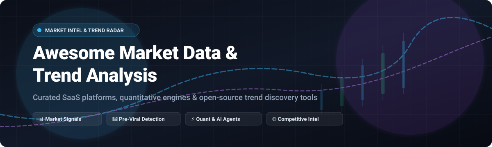

  

# 📈 Awesome Market & Data Trend Analysis 🔍

  
  
  
  
  
  

> 🌐 A curated list of top Market and Data Trend Analysis platforms — featuring enterprise SaaS/hosted solutions and top open-source alternatives for discovering emerging trends, analyzing market data, tracking competitive intelligence, and building financial intelligence pipelines.  
> 🌟 Star this repo if you find it useful! 🌟

---

## 📋 Table of Contents

- [🌐 Sector Overview & Market Dynamics](#-sector-overview--market-dynamics)
- [🟦 SaaS / Hosted Platforms](#-saas--hosted-platforms)
- [🟩 Open-Source Software](#-open-source-software)
  - [OpenBB](#openbb)
  - [yfinance](#yfinance)
  - [ta (Technical Analysis Library in Python)](#ta-technical-analysis-library-in-python)
  - [pytrends](#pytrends)
  - [SerpBear](#serpbear)
  - [TrendPulse](#trendpulse)
  - [Capbase](#capbase)
  - [finasys](#finasys)
  - [TrendScout Radar](#trendscout-radar)
  - [Alion (LangChain Toolkit)](#alion-langchain-toolkit)
- [📊 Feature Comparison Matrix](#-feature-comparison-matrix)
- [💖 Support](#-support)
- [📈 Star History](#-star-history)
- [🤝 Contributing](#-contributing)
- [📄 License](#-license)

---

## 🌐 Sector Overview & Market Dynamics

The global market intelligence and data trend analysis platform market is estimated at **$8.6B to $12.1B** (projected to exceed **$21B by the 2030s** at an 8.2%–9.8% CAGR) 📊. The sector is **moderately to highly fragmented** rather than a winner-take-all monopoly: while mega-cap tech conglomerates and institutional incumbents (Google, Morningstar/PitchBook, Semrush) dominate horizontal search, private equity, and search marketing intelligence respectively, hundreds of specialized agile vendors thrive by servicing targeted niches such as early consumer breakout detection, vertical industry telemetry, and developer-first algorithmic intelligence 🚀.

---

## 🟦 SaaS / Hosted Platforms

Commercial, cloud-hosted Market and Data Trend Analysis platforms ranked in descending order by company scale (market capitalization or valuation/revenue) 💼.

| Platform | Category / Focus | Company Scale (Valuation / Revenue) | Starting Tier Pricing | Free Tier / Free Trial Limits | Key Strengths |
|:---|:---|:---|:---|:---|:---|
| **[Google Trends](https://trends.google.com)** 🔎 | Search Interest & Macro Trends | **$3.5T+ Market Cap** (Alphabet / ~$400B+ Ann. Rev.) | **Free** ($0) / Scraper APIs start ~$25/mo | **Free forever plan**: Unlimited search queries on web interface; 0–100 normalized scores; 5 concurrent keyword comparisons | Unrivaled global search query sample size; historical query trends dating back to 2004; geographic drilldowns. |
| **[PitchBook](https://pitchbook.com)** 📊 | Private Capital & VC/PE Deal Intelligence | **Subsidiary of Morningstar** ($14B+ Cap; PitchBook rev. ~$671M) | **~$12,000 / year** ($1,000/mo single seat) | **No free-forever plan**; vetted trial only upon sales qualification (typically 7–14 days with export restrictions) | Industry-standard valuation multiples, deal terms, cap table estimates, and institutional LP/GP allocations. |
| **[Semrush](https://www.semrush.com)** 🎯 | Search Trend & Competitive Traffic Intelligence | **~$1.6B Valuation** (~$443M Ann. Rev.) | **$139.00 / month** ($117.33/mo billed annually) | **Free forever plan**: 10 daily searches/reports across domain & keyword analytics; 1 demo project with 10 tracked keywords | Comprehensive digital market visibility, competitive search volume tracking, backlink intelligence, and SERP trends. |
| **[Similarweb](https://www.similarweb.com)** 🌐 | Web Traffic & Digital Market Intelligence | **~$700M Market Cap** (NYSE: SMWB; ~$282M Ann. Rev.) | **$125.00 / month** (billed annually, or $199/mo monthly) | **7-day free trial** with credit card required (capped at 1 seat, 3 months historical data, and no raw bulk exports) | Global website traffic estimation, referral source attribution, audience overlap analytics, and funnel conversion tracking. |
| **[Crunchbase](https://www.crunchbase.com)** 🏢 | Startup Funding & Growth Market Signals | **~$150M Valuation** (~$35M–$40M Ann. Rev.) | **$49.00 / month** (billed annually for new users; $99/mo monthly) | **Free forever plan**: Access to basic company profiles with search results capped at first 5 rows and 0 data exports; 7-day Pro free trial available | Definitive database of venture funding rounds, active investors, executive leadership, and emerging startup signals. |
| **[CB Insights](https://www.cbinsights.com)** 🧠 | Tech Market Maps & Emerging Industry Signals | **~$75M–$80M ARR** (Private / Bootstrapped) | **~$24,700 / year** (Median contract ~$47,000/year) | **10-day free trial** with corporate email verification (no credit card required; access to terminal and AI agent reports) | Proprietary tech vendor mosaics, emerging technology heatmaps, patent landscaping, and earnings call transcript mining. |
| **[Exploding Topics](https://explodingtopics.com)** ⚡ | Rapid Pre-Viral Consumer & Market Trends | **Acquired by Semrush** (~$1M–$3M ARR) | **$39.00 / month** (billed annually at $468/yr) | **Free forever plan**: Public trending topics database with basic weekly newsletter; 7-day trial of Pro features | Algorithmic early-signal detection of products, technologies, and consumer keywords before hitting mainstream search volume. |

---

## 🟩 Open-Source Software

Self-hosted, community-driven Market and Data Trend Analysis tools and libraries, sorted in descending order by GitHub stargazers 🌟.

### OpenBB
  
**Stack:** Python / FastAPI 🐍 | **License:** AGPL-3.0 / Commercial ⚖️  
OpenBB (formerly Gamestonk Terminal) is the leading open-source investment research software platform. It provides an institutional-grade, modular financial terminal and Python data engine aggregating equities, macro trends, cryptocurrencies, venture capital, and options data across dozens of free and premium financial data vendors.  
- **Multi-Asset Intelligence:** Deep fundamental data, macro charts, economic releases, and insider transactions.
- **Agent Integration:** First-class support for LLM-powered market data retrieval and custom copilot plugins.  
**Best for:** Financial analysts, quants, and developers seeking an open-source terminal alternative to Bloomberg or PitchBook.

---

### yfinance
  
**Stack:** Python 🐍 | **License:** Apache-2.0 ⚖️  
yfinance provides a robust, threaded Python client to fetch historical market data, fundamental metrics, option chains, and corporate actions from Yahoo! Finance. It serves as the primary data extraction layer for thousands of open-source algorithmic trading and market analysis systems.  
- **High-Resolution Data:** Pulls intraday, daily, and long-term historical price and volume time series.
- **Financial Statements:** Direct access to quarterly balance sheets, cash flow statements, and earnings estimates.  
**Best for:** Python developers and data scientists needing friction-free market pricing data for time-series modeling.

---

### ta (Technical Analysis Library in Python)
  
**Stack:** Python / Pandas / NumPy 🐼 | **License:** MIT ⚖️  
A comprehensive technical analysis library that computes over 40 technical indicators on top of Pandas DataFrames. It is built to extract trend signals, momentum shifts, volatility cycles, and volume accumulations from raw market price feeds.  
- **Indicator Suite:** Moving averages (EMA, SMA, VWAP), MACD, Bollinger Bands, RSI, Ichimoku, ADX, and ATR.
- **Clean Feature Extraction:** Outputs clean, normalized DataFrame columns ideal for machine learning pipelines.  
**Best for:** Quantitative analysts and traders building algorithmic trend filters and trading bots.

---

### pytrends
  
**Stack:** Python 🐍 | **License:** Apache-2.0 ⚖️  
pytrends is the unofficial Python API wrapper for Google Trends. It automates the extraction of normalized search interest over time, regional interest heatmaps, related search topics, and real-time trending queries without manual UI interaction.  
- **Automated Ingestion:** Programmatically extracts 0–100 interest scores for single or batched keywords.
- **Discovery Tools:** Queries Google's suggestion endpoint for auto-completion trends and breakout queries.  
**Best for:** Growth hackers, marketers, and researchers running automated consumer demand trend scripts.

---

### SerpBear
  
**Stack:** Node.js / Next.js / Docker 🐳 | **License:** MIT ⚖️  
SerpBear is an open-source, self-hosted SEO search position tracker and competitive visibility dashboard. It estimates search traffic volume using the classical keyword ranking multiplied by search volume model, providing an open-source alternative to the core tracking features of Semrush and Ahrefs.  
- **Competitor Tracking:** Tracks daily keyword positions and SERP movement across mobile and desktop.
- **Direct Console Integration:** Integrates with Google Search Console for verified CTR and impression telemetry.  
**Best for:** SEO teams and digital marketers seeking private, self-hosted competitor rank tracking without recurring SaaS fees.

---

### TrendPulse
  
**Stack:** Python / SQLite / MCP 🤖 | **License:** MIT ⚖️  
TrendPulse is a multi-source agentic trend intelligence platform and MCP server. It connects to 35+ free data sources (including Google Trends RSS, Hacker News, Bluesky, Mastodon, Reddit, PyPI, and GitHub) to discover, cluster, and score accelerating topics across developer and mainstream ecosystems.  
- **Velocity Scoring:** Tracks trend acceleration and directional velocity stored in local SQLite databases.
- **MCP Server Support:** Features built-in Model Context Protocol tools for native Claude Code and AI agent integrations.  
**Best for:** Creators and AI agent developers building automated multi-platform trend-scanning bots.

---

### Capbase
  
**Stack:** Open Web / Community Database 🌐 | **License:** Open Source ⚖️  
Capbase is a community-driven open-source alternative to Crunchbase and PitchBook. It aggregates venture capital funding rounds, founder profiles, and company registries by harvesting public filings (SEC EDGAR, UK Companies House, SBIR grants, and Wikidata).  
- **Crowdsourced Intelligence:** Contributors unlock complete database access by submitting or verifying company funding rounds.
- **Public Data Grounding:** Focuses on verified regulatory filings rather than paywalled promotional releases.  
**Best for:** Founders, angel investors, and venture scouts seeking startup funding records without expensive corporate tiers.

---

### finasys
  
**Stack:** Python / Polars / DuckDB ⚡ | **License:** MIT ⚖️  
finasys is a high-performance financial feature engineering and data processing toolkit tailored for machine learning pipelines and quantitative AI agents. Built natively on Polars and DuckDB, it executes 10x–100x faster than traditional Pandas-based indicator packages.  
- **Quantitative Labeling:** Generates forward returns, volatility regimes, and triple-barrier classification labels.
- **Instant Caching:** Ingests parquet, CSV, and Yahoo Finance data directly into cached columnar memory.  
**Best for:** Machine learning engineers and quant developers building high-throughput financial prediction models.

---

### TrendScout Radar
  
**Stack:** Python / GitHub Actions 📡 | **License:** Open Source ⚖️  
An open-source multi-platform trend scanner that monitors emerging topics across TikTok, YouTube, Reddit, Google, and Hacker News. Positioned as an open-source Exploding Topics competitor, it flags breakout topics when a keyword trends simultaneously across 3+ platforms and sends alerts directly to Slack, Discord, and Telegram.  
- **Cross-Platform Correlation:** Flags multi-network breakout topics before they hit mainstream search volume.
- **Zero-Infrastructure Execution:** Runs seamlessly via scheduled GitHub Actions workflows.  
**Best for:** Social media strategists, e-commerce scouts, and content creators monitoring viral shifts.

---

### Alion (LangChain Toolkit)
  
**Stack:** Python / LangChain / MCP 🔗 | **License:** Apache-2.0 ⚖️  
Alion provides LangChain tools and MCP connectors for a live global knowledge graph of companies worldwide. It enables autonomous AI agents to query verified company profiles, technology stacks, funding stages, hiring velocity, and competitor lookalikes.  
- **Agentic Market Research:** Enables LLM reasoning loops to look up company firmographics and counterparty validity.
- **Free Developer API:** Includes 300 free API queries per day without upfront payment requirements.  
**Best for:** Developers building autonomous AI agents for B2B competitive intelligence and corporate research.

---

## 📊 Feature Comparison Matrix

| Platform / Tool | Type | License / Model | Trend Discovery | Company & Funding Data | Traffic & SEO Analytics | Self-Hosted | Primary Target Audience |
|:---|:---|:---|:---:|:---:|:---:|:---:|:---|
| **Google Trends** 🔎 | SaaS | Free Proprietary | ✅ | ❌ | ❌ | ❌ | Marketers & macro researchers |
| **PitchBook** 📊 | SaaS | Enterprise Proprietary | ✅ | ✅ | ❌ | ❌ | Institutional investors, PE/VC & M&A |
| **Semrush** 🎯 | SaaS | Tiered Subscription | ❌ | ❌ | ✅ | ❌ | SEO agencies & search marketers |
| **Similarweb** 🌐 | SaaS | Tiered Subscription | ❌ | ❌ | ✅ | ❌ | Digital strategists & media buyers |
| **Crunchbase** 🏢 | SaaS | Freemium Subscription | ✅ | ✅ | ❌ | ❌ | Startup scouts, founders & sales reps |
| **CB Insights** 🧠 | SaaS | Enterprise Annual | ✅ | ✅ | ❌ | ❌ | Corporate innovation & strategy teams |
| **Exploding Topics** ⚡ | SaaS | Freemium Subscription | ✅ | ❌ | ❌ | ❌ | Content creators, investors & founders |
| **OpenBB** 🏆 | Open Source | AGPL-3.0 | ✅ | ✅ | ❌ | ✅ | Quants, hedge funds & financial analysts |
| **yfinance** 🐍 | Open Source | Apache-2.0 | ❌ | ❌ | ❌ | ✅ | Algorithmic traders & data scientists |
| **ta** 📈 | Open Source | MIT | ✅ | ❌ | ❌ | ✅ | Quant researchers & indicator developers |
| **pytrends** 🔍 | Open Source | Apache-2.0 | ✅ | ❌ | ❌ | ✅ | Data engineers & growth hackers |
| **SerpBear** 🐻 | Open Source | MIT | ❌ | ❌ | ✅ | ✅ | Indie hackers & SEO specialists |
| **TrendPulse** 📡 | Open Source | MIT | ✅ | ❌ | ❌ | ✅ | AI agent engineers & trend analysts |
| **Capbase** 💡 | Open Source | Community Open | ❌ | ✅ | ❌ | ✅ | Researchers & bootstrapped founders |
| **finasys** ⚡ | Open Source | MIT | ❌ | ❌ | ❌ | ✅ | ML engineers & high-frequency quants |
| **TrendScout Radar** 🛰️ | Open Source | Open Source | ✅ | ❌ | ❌ | ✅ | Social media strategists & creators |
| **Alion SDK** 🔗 | Open Source | Apache-2.0 | ❌ | ✅ | ❌ | ✅ | LangChain / AI agent builders |

---

## 💖 Support

A huge thank you to everyone exploring, starring, and contributing to this curated repository! 🙌

If you find this project valuable for your research, trading strategies, or market intelligence workflows, here is how you can support ongoing maintenance:
- 🌟 **Star** the repository on GitHub to boost visibility
- 🍴 **Fork** and contribute tools, updates, and open-source alternatives
- 📢 **Share** with your network, team, or fellow data enthusiasts
- ☕ **Buy a Coffee / Sponsor**: Support direct development on the [GitHub Sponsors Dashboard](https://github.com/sponsors/ishandutta2007)

---

##  Star History

---

## 🤝 Contributing

Contributions are warmly welcomed! 🌟 If you maintain or use an open-source market data, trend forecasting, or competitive intelligence project that belongs here:

1. 🍴 Fork this repository.
2. 🌿 Create a dedicated branch: `git checkout -b feature/add-new-tool`.
3. 📝 Add the project under the **Open-Source Software** section with:
   - Project name and repository link
   - Social star count badge (`https://img.shields.io/github/stars/<owner>/<repo>?style=social&color=white`) linking to its stargazers page
   - Tech stack and license
   - Summary of capabilities and ideal use case
4. 🔄 Update the **Table of Contents** and **Comparison Matrix**.
5. 🚀 Submit a pull request.

Please verify that the repository is genuinely open-source, actively maintained, and relevant to market and trend intelligence workflows.

---

## 📄 License

This repository and curated collection are released under the [CC0 1.0 Universal (Public Domain Dedication)](http://creativecommons.org/publicdomain/zero/1.0/). Listed software tools, brand names, and trademarks belong to their respective copyright holders.
